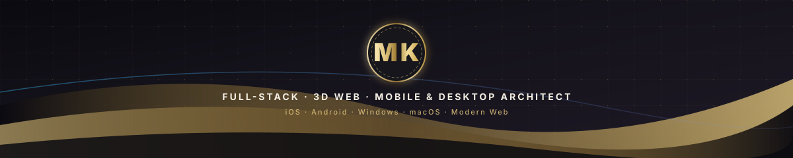
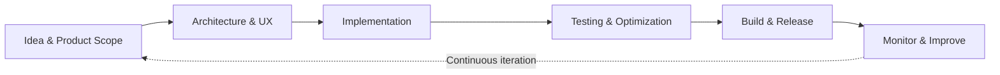
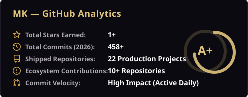
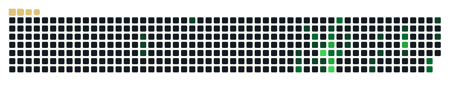

<div align="center">

<a href="https://git.io/typing-svg"></a>

<br/>

<a href="https://t.me/TianyiXiong" target="_blank"></a>&nbsp;
<a href="https://github.com/LanKuzuMK" target="_blank"></a>&nbsp;
<a href="https://lankuzumk.github.io/mk-vault/" target="_blank"></a>&nbsp;
<a href="https://youtube.com/@jackmp3fx?si=19gciCczBXxYfRwn" target="_blank"></a>&nbsp;
<a href="https://www.facebook.com/share/165PRpanWb/" target="_blank"></a>

<br/><br/>


<a href="https://github.com/LanKuzuMK/LanKuzuMK/actions/workflows/profile-snake.yml">
  
</a>

</div>

<div align="center">
  <sub>
    <a href="#executive-summary">About</a> ·
    <a href="#multi-platform-engineering-ios--android--windows--macos--web">Platforms</a> ·
    <a href="#full-technical-arsenal">Tech Stack</a> ·
    <a href="#activity--statistics">Analytics</a> ·
    <a href="#featured-flagships">Flagships</a> ·
    <a href="#built-projects--master-index-22-projects">Projects</a> ·
    <a href="#open-for-collaboration">Contact</a>
  </sub>
</div>

<br/>

<!-- ═══════════════════════════════════════════════════════ -->
<!-- ABOUT ME & MULTI-PLATFORM CAPABILITIES -->
<!-- ═══════════════════════════════════════════════════════ -->

## 👨‍💻 Executive Summary

```yaml
name: MK
handle: "@LanKuzuMK"
title: Full-Stack, Mobile & Desktop Engineer • Creative Technologist
based_in: Cambodia 🇰🇭

platforms_supported:
  mobile:  [iOS, Android]
  desktop: [Windows, macOS]
  web:     [Modern Browsers, 3D WebGL, Responsive SPAs]

currently_building:
  - Cross-platform mobile applications for iOS & Android with Flutter, Dart & Capacitor
  - Native & hybrid desktop software for Windows & macOS
  - 3D interactive web experiences with Three.js, GSAP & WebGL
  - Full-stack production platforms with React 19, TypeScript, Node.js & Java

core_principles:
  - Build clean, build complete, build production-grade
  - Performance is a feature, not an afterthought
  - Unified multi-platform continuity across every device and screen

fun_fact: "I hate AI, but not too much." 😉
```

<br/>

<!-- ═══════════════════════════════════════════════════════ -->
<!-- MULTI-PLATFORM ECOSYSTEM -->
<!-- ═══════════════════════════════════════════════════════ -->

## 📱 Multi-Platform Engineering (iOS · Android · Windows · macOS · Web)

I build, package, and deploy software across every major consumer and enterprise operating system:

<div align="center">

<p>
  
  
  
  
  
</p>

<!-- Mobile & Desktop Toolchain Skill Icons with zero gaps -->
<a href="https://skillicons.dev">
  
</a>

</div>

<br/>

| Target Platform | Runtime & Frameworks | Native Languages | What I Build |
|:----------------|:-----------------------------------------|:------------------------|:-----------------------------------------------------------------------------------------|
| 📱 **iOS** | `Flutter` · `Capacitor` · `React Native` | `Swift` · `Objective-C` | App Store builds, mobile games, utilities, and native sensor integrations. |
| 🤖 **Android** | `Flutter` · `Android SDK` · `Capacitor` | `Kotlin` · `Java` | Production APK & AAB releases, foreground services, offline caching, and responsive UIs. |
| 🪟 **Windows** | `Flutter Desktop` · `Electron` · `Tauri` | `C# / .NET` · `C++` | High-performance Windows desktop tools, utility dashboards, and local executable apps. |
| 🍏 **macOS** | `Flutter Desktop` · `Electron` · `Tauri` | `Swift` · `Objective-C` | Clean macOS desktop applications adhering to Apple Human Interface Guidelines. |

### Engineering Workflow



<br/>

<!-- ═══════════════════════════════════════════════════════ -->
<!-- TECH ARSENAL -->
<!-- ═══════════════════════════════════════════════════════ -->

## 🛠️ Full Technical Arsenal

<div align="center">

<a href="https://skillicons.dev">
  
</a>

</div>

<br/>

<details>
<summary><b>📋 Detailed Technology & Framework Breakdown</b></summary>
<br/>

| Domain | Technologies & Tooling |
|:--------------------------|:----------------------------------------------------------------------------------------------|
| **Programming Languages** | `JavaScript` · `TypeScript` · `Java` · `Dart` · `Swift` · `Kotlin` · `HTML5` · `CSS3` |
| **Mobile Platforms** | `iOS` (App Store) · `Android` (Play Store / APK) · `Flutter` · `Capacitor` · `Android Studio` |
| **Desktop Platforms** | `Windows` (Win32 / Universal) · `macOS` · `Flutter Desktop` · `Electron` · `Tauri` |
| **Web Frontend** | `React 19` · `Three.js` · `GSAP 3.15` · `Tailwind CSS 4` · `Vite` · `WebGL` · `Lenis` |
| **Backend & APIs** | `Node.js` · `Express` · `tRPC` · `Drizzle ORM` · `JSP / Servlet` |
| **3D & Game Tech** | `Three.js r187` · `WebGL 2.0` · `Web Audio API` · `Canvas 2D` · `Procedural PBR Textures` |
| **Database Systems** | `MySQL` · `PostgreSQL` · `Cloudflare D1 (SQLite)` · `Drizzle Kit` |
| **DevOps & Cloud** | `GitHub Actions` · `Vercel` · `Cloudflare Pages` · `Render` · `Docker` |
| **UI/UX & Design** | `Figma` · `Royal Ledger System` · `Glassmorphism` · `Responsive Layouts` |

</details>

<br/>

<!-- ═══════════════════════════════════════════════════════ -->
<!-- GITHUB ANALYTICS (FIXED WORKING SERVERS) -->
<!-- ═══════════════════════════════════════════════════════ -->

## 📊 Activity & Statistics

<div align="center">




</div>

<br/>

## 🐍 Contribution Flow

<div align="center">

<picture>
  <source media="(prefers-color-scheme: dark)" srcset="./assets/github-snake-dark.gif" />
  <source media="(prefers-color-scheme: light)" srcset="./assets/github-snake-light.gif" />
  
</picture>

<sub>Automatically regenerated every day with GitHub Actions.</sub>

</div>

<br/>

<!-- ═══════════════════════════════════════════════════════ -->
<!-- FEATURED FLAGSHIP PROJECTS (BALANCED FULL-WIDTH TRIM) -->
<!-- ═══════════════════════════════════════════════════════ -->

## ⭐ Featured Flagships

<table width="100%">
<tr>
<td width="60" align="center" valign="top">
  <h2>01</h2>
</td>
<td>
  <a href="https://lankuzumk.github.io/mk-vault/"><h3>🏛️ MK Vault — Royal Ledger Archive</h3></a>
  <p>
    
    
    
  </p>
  <p>A curated personal link archive built with the bespoke Royal Ledger visual system — dark ink canvas, burnished brass accents, archival Cinzel typography, monogram seal, automated web screenshots, real-time search & category filtering, and an owner workspace with JSON backup export and restore.</p>
  <p>
    <a href="https://lankuzumk.github.io/mk-vault/"></a>
    <a href="https://github.com/LanKuzuMK/mk-vault"></a>
    
    &nbsp;&nbsp;<b><a href="https://lankuzumk.github.io/mk-vault/">[Open ↗]</a></b>
  </p>
</td>
</tr>

<tr>
<td width="60" align="center" valign="top">
  <h2>02</h2>
</td>
<td>
  <a href="https://read-me-by-jack.vercel.app/"><h3>📖 Read Me by Jack — 3D WebGL Studio</h3></a>
  <p>
    
    
    
  </p>
  <p>Studio-grade 3D interactive editorial experience celebrating the release of Read Me by Jack — cinematic camera spline navigating five choreographed desk chapters, procedural PBR textures, steam particle vortex, day/night lighting, 120Hz/144Hz locked rendering, progressive cursive calligraphy signature, and procedural Web Audio synthesizer.</p>
  <p>
    <a href="https://read-me-by-jack.vercel.app/"></a>
    <a href="https://github.com/LanKuzuMK/read-me-by-jack"></a>
    
    &nbsp;&nbsp;<b><a href="https://read-me-by-jack.vercel.app/">[Open ↗]</a></b>
  </p>
</td>
</tr>

<tr>
<td width="60" align="center" valign="top">
  <h2>03</h2>
</td>
<td>
  <a href="https://mk-pro-portfolio.pages.dev/"><h3>🌐 MK Pro Portfolio — Cinematic Portfolio</h3></a>
  <p>
    
    
    
  </p>
  <p>Bilingual cinematic portfolio for MK — fluid page transitions, custom typography system, interactive project showcase, and responsive mobile-first grid architecture engineered for Developer & Creative Technologist positioning.</p>
  <p>
    <a href="https://mk-pro-portfolio.pages.dev/"></a>
    <a href="https://github.com/LanKuzuMK/mk-pro-portfolio"></a>
    
    &nbsp;&nbsp;<b><a href="https://mk-pro-portfolio.pages.dev/">[Open ↗]</a></b>
  </p>
</td>
</tr>
</table>

<br/>

<!-- ═══════════════════════════════════════════════════════ -->
<!-- FULL PROJECT CATALOG (ALL 22 LINKS STANDARDIZED TO "OPEN") -->
<!-- ═══════════════════════════════════════════════════════ -->

## 🏛️ Built Projects — Master Index (22 Projects)

The complete catalog of web applications, mobile apps, games, tools, and platforms I have built and deployed:

### 🎮 Games & 3D Experiences

| \# | Project | Target Platforms | Tech Stack | Link |
|:------:|:-----------------------------------------------------------------------------------------------------------------------------------------------------------|:------------------------:|:--------------------------------------|:------------------------------------------------------:|
| **04** | [**Skybound Knight**](https://skybound-knight-play.pages.dev/) — Endless fantasy platformer with responsive physics collision and Android APK support | `Android` · `Web` | `TypeScript` · `Canvas` · `Capacitor` | [**Open**](https://skybound-knight-play.pages.dev/) |
| **05** | [**Gundam Strike Protocol**](https://gundam-strike-protocol.vercel.app/) — Tactical mech combat action game with sequence animations and particle effects | `Web` · `Mobile Browser` | `TypeScript` · `Canvas` · `Vite` | [**Open**](https://gundam-strike-protocol.vercel.app/) |
| **06** | [**MK Christmas Tree Love**](https://mkchristmastreelove.vercel.app/) — Interactive 3D Christmas tree visualizer with particle snowfall and seasonal audio | `Web` · `WebGL` | `Three.js` · `WebGL` · `JavaScript` | [**Open**](https://mkchristmastreelove.vercel.app/) |

### ⚙️ Web Applications & Platforms

| \# | Project | Target Platforms | Tech Stack | Link |
|:------:|:-------------------------------------------------------------------------------------------------------------------------------------------------------------------------------------|:---------------------:|:---------------------------------------|:--------------------------------------------------------------------------:|
| **07** | [**Student OS v2**](https://student-os-v2.onrender.com/) — Student academic hub for task management, goal tracking, skill trees, freelance jobs, and peer chat | `Web` · `Desktop Web` | `Java` · `JSP` · `MySQL` · `Bootstrap` | [**Open**](https://student-os-v2.onrender.com/) |
| **08** | [**StudentOS Reference**](https://studentos-reference.vercel.app/) — Searchable implementation reference and documentation for custom profile links | `Web` · `Mobile Web` | `TypeScript` · `React` · `Vite` | [**Open**](https://studentos-reference.vercel.app/) |
| **09** | [**Lunara**](https://lunara-feminine-care.onrender.com/) — Healthcare & wellness tracking application with menstrual cycle analytics and care logs | `Web` · `Mobile Web` | `Node.js` · `Express` · `JavaScript` | [**Open**](https://lunara-feminine-care.onrender.com/) |
| **10** | [**Daily Income Organizer**](https://mk-website-five.vercel.app/daily-income-organizer.html) — Personal finance tracker with daily earnings logging, category breakdown, and metrics | `Web` · `Mobile` | `HTML5` · `CSS3` · `JavaScript` | [**Open**](https://mk-website-five.vercel.app/daily-income-organizer.html) |
| **11** | [**Anonymous Chat**](https://anonymouse-chat-1.onrender.com/) — Real-time anonymous messaging platform featuring WebSocket channels and ephemeral chat rooms | `Web` · `Mobile Web` | `Node.js` · `Socket.io` · `TypeScript` | [**Open**](https://anonymouse-chat-1.onrender.com/) |
| **12** | [**MK Schedule**](https://mk-schedule.vercel.app/) — Personal scheduling and calendar management system with visual time-block organization | `Web` · `Mobile` | `React` · `TypeScript` · `Vite` | [**Open**](https://mk-schedule.vercel.app/) |
| **13** | [**CostWebby**](https://costwebby-mk.vercel.app/) — Project small university web for testing | `Web` · `Desktop` | `React` · `JavaScript` · `Vite` | [**Open**](https://costwebby-mk.vercel.app/) |

### 🤖 AI, Bots & Computer Vision

| \# | Project | Target Platforms | Tech Stack | Link |
|:------:|:----------------------------------------------------------------------------------------------------------------------------------------------------------------------------------------|:-------------------------:|:--------------------------------------|:-----------------------------------------------------------------------:|
| **14** | [**Mini Jack Bot**](https://mini-jack-by-mk-bot.vercel.app/) — Conversational AI companion bot featuring interactive dialogue and customizable personality | `Web` · `Telegram Bot` | `TypeScript` · `Node.js` · `AI SDK` | [**Open**](https://mini-jack-by-mk-bot.vercel.app/) |
| **15** | [**Gesture on Air**](https://gesture-on-air.vercel.app/) — Real-time hand gesture recognition and air-drawing interface powered by computer vision | `Web` · `Camera / WebCam` | `MediaPipe` · `Canvas` · `JavaScript` | [**Open**](https://gesture-on-air.vercel.app/) |
| **16** | [**E-Commerce Inventory Dashboard**](https://github.com/LanKuzuMK/e-commerce-inventory-dashboard) — Live inventory management with automated low-stock warnings, analytics, and metrics | `Server` · `Web Desktop` | `Java` · `JSP` · `MySQL` | [**Open**](https://github.com/LanKuzuMK/e-commerce-inventory-dashboard) |

### 🎨 Portfolios & Showcases

| \# | Project | Target Platforms | Tech Stack | Link |
|:------:|:-------------------------------------------------------------------------------------------------------------------------------------------------------------------------------------------|:--------------------:|:-------------------------------------|:---------------------------------------------------------------:|
| **17** | [**Grand MK Nexus**](https://grand-mk-nexus.vercel.app/) — Central portal connecting all MK web projects with animated navigation and unified identity | `All Platforms` | `TypeScript` · `React` · `Vite` | [**Open**](https://grand-mk-nexus.vercel.app/) |
| **18** | [**MK Portfolio v2 — Code Cultivator**](https://mk-portfolio-v2-code-cultivator.vercel.app/) — Second-generation portfolio with botanical growth metaphor and interactive project showcase | `Web` · `Mobile` | `React` · `TypeScript` · `Tailwind` | [**Open**](https://mk-portfolio-v2-code-cultivator.vercel.app/) |
| **19** | [**Khmer Map by MK**](https://khmer-map-by-mk.vercel.app/) — Interactive geographical map of Cambodia with province boundaries, cultural data, and Khmer typography | `Web` · `Mobile` | `Leaflet` · `GeoJSON` · `JavaScript` | [**Open**](https://khmer-map-by-mk.vercel.app/) |
| **20** | [**MK Fitness God**](https://mkfitnessgod.vercel.app/) — Fitness tracking application with workout logging, progress visualization, and training routines | `Web` · `Mobile PWA` | `React` · `JavaScript` · `Vite` | [**Open**](https://mkfitnessgod.vercel.app/) |
| **21** | [**Jack Portfolio One**](https://jack-portfolio-one.vercel.app/) — First-generation portfolio site with clean grid showcase and project cards | `Web` | `HTML5` · `CSS3` · `JavaScript` | [**Open**](https://jack-portfolio-one.vercel.app/) |
| **22** | [**Surreal Universe**](https://surreal-universe-portfolio.vercel.app/) — 3D creative technologist & graphic design portfolio with surrealist cosmos visuals, interactive audio & motion | `Web` · `3D WebGL` | `React` · `Three.js` · `Tailwind` · `Vite` | [**Open**](https://surreal-universe-portfolio.vercel.app/) |

<br/>

<!-- ═══════════════════════════════════════════════════════ -->
<!-- PHILOSOPHY & COLLABORATION -->
<!-- ═══════════════════════════════════════════════════════ -->

## ✨ Engineering Philosophy

- **Product-minded engineering:** solve the real problem before adding complexity.
- **Cross-platform by design:** deliver consistent experiences across phones, desktops, and browsers.
- **Motion with purpose:** use animation to clarify hierarchy and make interfaces feel responsive, never to distract.
- **Reliable delivery:** prioritize accessibility, performance, maintainability, and production-ready releases.

## 🤝 Open for Collaboration

I am open to collaborating on **iOS & Android mobile apps**, **Windows & macOS software**, **3D web experiences**, and **full-stack platforms**. If you have an idea, want to build something together, or need a developer with a proven track record across all major platforms:

<div align="center">

| Channel | Contact / Link | Action |
|:---------------------|:-----------------------------------------------------------------|:--------------------------------------------------------------:|
| 💬 **Telegram** | [@TianyiXiong](https://t.me/TianyiXiong) | [**Open**](https://t.me/TianyiXiong) |
| 🎥 **YouTube** | [@jackmp3fx](https://youtube.com/@jackmp3fx?si=19gciCczBXxYfRwn) | [**Open**](https://youtube.com/@jackmp3fx?si=19gciCczBXxYfRwn) |
| 👤 **Facebook** | [MK Profile](https://www.facebook.com/share/165PRpanWb/) | [**Open**](https://www.facebook.com/share/165PRpanWb/) |
| 🐙 **GitHub** | [LanKuzuMK](https://github.com/LanKuzuMK) | [**Open**](https://github.com/LanKuzuMK) |
| 🏛️ **Project Vault** | [MK Vault](https://lankuzumk.github.io/mk-vault/) | [**Open**](https://lankuzumk.github.io/mk-vault/) |

</div>

<br/>

<div align="center">
  
</div>

<br/>


